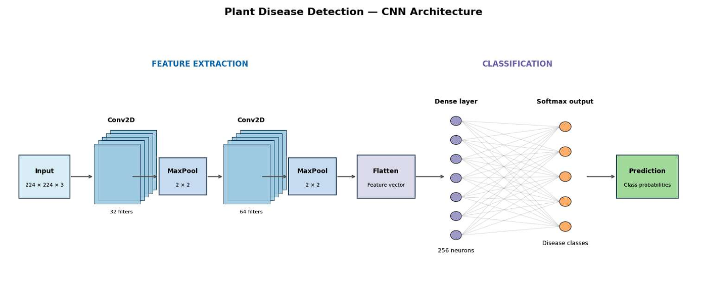
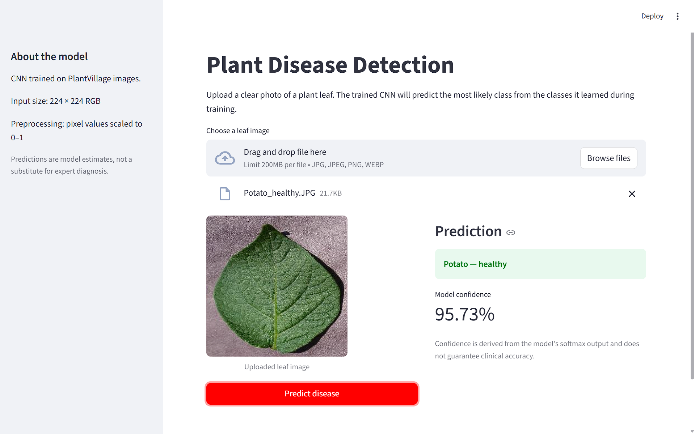
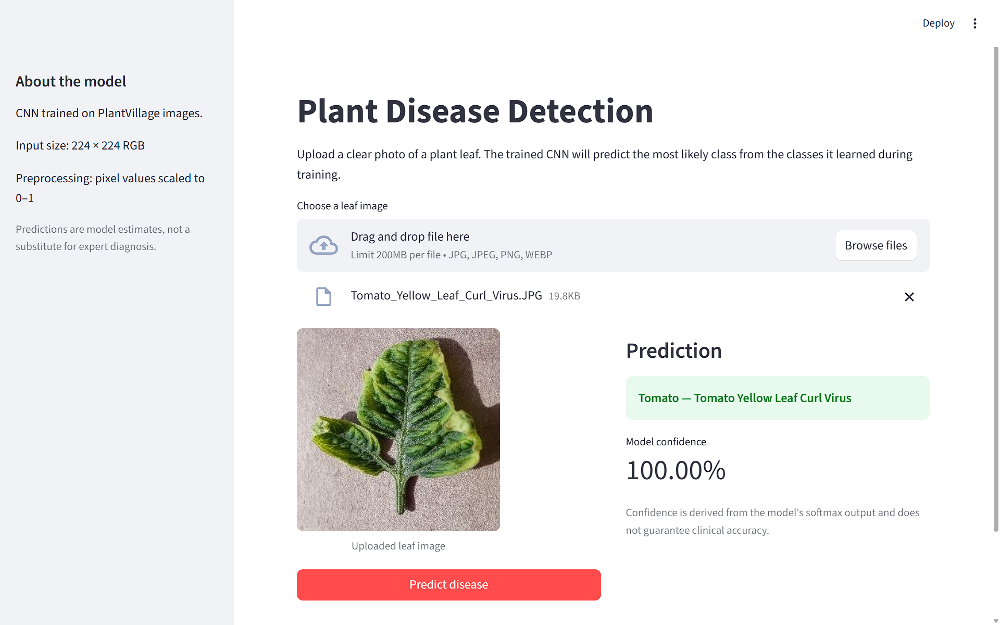

# Plant Disease Detection Using CNN

A deep learning project that classifies plant leaf images into disease and healthy categories using a custom Convolutional Neural Network (CNN). The project includes a Jupyter notebook for model training and evaluation, along with a Streamlit application for interactive predictions.

## Overview

Plant diseases can reduce crop health and agricultural productivity. This project explores how convolutional neural networks can identify visual patterns in leaf images and classify them into learned disease categories.

The trained model accepts a plant leaf image and returns the most likely class along with its model confidence.

## Features

- Custom CNN developed using TensorFlow and Keras.
- Classification across 38 plant disease and healthy-leaf categories.
- Image preprocessing and normalization.
- Training and validation performance visualizations.
- Top-three class predictions when the model confidence is below the configured threshold.
- Interactive Streamlit application for image upload and prediction.

## Dataset

**PlantVillage Dataset — Kaggle**

Dataset link: https://www.kaggle.com/datasets/abdallahalidev/plantvillage-dataset

The dataset contains images of plant leaves representing different plant species and health conditions.

| Property | Configuration |
|---|---|
| Number of classes | 38 |
| Input image size | 224 × 224 pixels |
| Image channels | RGB |
| Pixel normalization | Values scaled to 0–1 |

The dataset is not included in this repository. Refer to `dataset.txt` for the source information.

## Model Architecture

The project uses a custom CNN to learn image features and classify plant leaf images.

The network follows the general workflow:

1. **Input:** RGB leaf image resized to 224 × 224 pixels.
2. **Convolutional layers:** Learn features such as edges, textures, and disease patterns.
3. **Max pooling:** Reduces the spatial dimensions of feature maps.
4. **Flattening:** Converts extracted feature maps into a one-dimensional vector.
5. **Dense layers:** Learn combinations of the extracted features.
6. **Softmax output:** Produces class probabilities for the 38 categories.

The exact layer configuration and training procedure are documented in `plant.ipynb`.

## Repository Structure

```text
Plant-Disease-Detection/
├── plant.ipynb
├── app.py
├── class_indices.json
├── dataset.txt
├── requirements.txt
├── pdd_research_paper.pdf
├── Plant_Disease_Detection_SlideDeck.pptx
└── README.md
```

### File Descriptions

- `plant.ipynb` — Model development, training, evaluation, and visualizations.
- `app.py` — Streamlit application for plant disease predictions.
- `class_indices.json` — Mapping between model output indices and class names.
- `dataset.txt` — Dataset source information.
- `requirements.txt` — Python dependencies.
- `pdd_research_paper.pdf` — Project research paper.
- `Plant_Disease_Detection_SlideDeck.pptx` — Project presentation.

## Screenshots

### 1. CNN Model Architecture

The architecture diagram illustrates the image classification pipeline, from input preprocessing and convolutional feature extraction to dense layers and the final Softmax classification output.



### 2. Plant Disease Prediction — Healthy Leaf

The application predicts a healthy potato leaf and displays the model's confidence score.



### 3. Plant Disease Prediction — Diseased Leaf

The application identifies Tomato Yellow Leaf Curl Virus from the uploaded leaf image and displays the prediction confidence.




## Training and Evaluation

The training workflow is documented in `plant.ipynb` and covers:

1. Loading the PlantVillage dataset.
2. Preprocessing leaf images.
3. Preparing training and validation data.
4. Building and training the CNN.
5. Visualizing accuracy and loss.
6. Evaluating model performance.
7. Saving the trained model and class-label mapping.

Actual accuracy and other evaluation metrics should be reported only after verifying the final model's evaluation results. Validation performance does not necessarily indicate performance on real-world images.

## Limitations

- Predictions are limited to the categories learned during training.
- Image quality, lighting, background, and camera conditions may affect performance.
- Performance on real-world field images may differ from performance on dataset images.
- The displayed confidence is derived from the model's softmax output and is not a guarantee of correctness.
- The tool is intended for experimentation and educational purposes, not as a substitute for expert agricultural diagnosis.

## Future Improvements

- Evaluate on a separate test dataset containing unseen images.
- Analyze per-class precision, recall, F1-score, and a confusion matrix.
- Explore data augmentation and regularization to reduce overfitting.
- Compare the custom CNN against transfer-learning architectures.
- Deploy the application for public access.

## Technologies Used

- Python
- TensorFlow and Keras
- NumPy
- Streamlit
- Pillow
- Matplotlib
- Pandas
- Scikit-learn
- Jupyter Notebook

## Author

**Amey Bonde**

- GitHub: [@ameybonde](https://github.com/ameybonde)
- LinkedIn: [Amey Bonde](https://www.linkedin.com/in/amey-bonde-72a8b23b2/)

## Dataset Attribution and License

This project uses the **PlantVillage Dataset**, made available on Kaggle by **Abdallah Ali and a collaborator**.

- **Dataset:** [PlantVillage Dataset](https://www.kaggle.com/datasets/abdallahalidev/plantvillage-dataset)
- **License listed on Kaggle:** [CC BY-NC-SA 4.0](https://creativecommons.org/licenses/by-nc-sa/4.0/)

The dataset is used for educational and research purposes. Please refer to the original dataset page for attribution requirements and license terms.

The dataset is not included in this repository. All rights to the original dataset remain with their respective rights holders.
